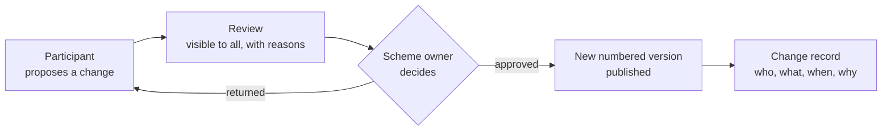

# The Contract as Data

## How ISDA rebuilt a market's paperwork

What a new payment scheme can learn from it

Ning Zhao · October 2026

<!--
- About 15 minutes, then questions.
- One case study: the International Swaps and Derivatives Association (ISDA), which maintains the contracts behind the over-the-counter derivatives market.
- Everything in this deck is public. Sources are on the last slide; the full essay has the detail and the code examples.
- Cover image: the ISDA document estate, illustration generated with Gemini.
-->

---
layout: center
class: text-center
---

# What does it mean to digitalise a body of legal documents?

### A better reading experience

Improves **access**.

### A new file format

Improves **maintenance**.

### Neither is the whole answer

The derivatives market shows what the rest looks like.

<!--
- A web portal makes the rulebook easier to read. A new editor or format makes it easier to maintain. Both are useful.
- Neither lets a machine, or an auditor, answer: which choice was made, in which version, changed by whom and why.
- ISDA faced this question at market scale, and answered it over a decade. That is the case study.
-->

---

# A library layered by reference

An over-the-counter derivative is not one contract. It is a stack of documents, each pointing at the others.

| Layer | What it is | Role |
|:---|:---|:---|
| **Master Agreement** (1992, 2002) | One standard text, never edited | The fixed core: default, termination, netting |
| **Schedule** | Bilateral elections | Where two parties make the standard their own |
| **Credit Support Annex** | Collateral terms | A separate, standard module |
| **Definitions** (2006, 2021, ...) | Shared vocabulary and calculation rules | Incorporated by reference, not copied |
| **Confirmations** | The economic terms of each trade | Short, because everything else is incorporated |
| **Protocols** | Multilateral amendments by adherence | One act amends thousands of agreements |

Standard text in one place. Negotiation confined to elections. Amendments travel by reference. **But it was built for paper.**

<!--
- Together the Master, Schedule, Confirmations and the Definitions they incorporate form a "single agreement" (Section 1(c)). That is what makes close-out netting work: an insolvent party's administrator cannot cherry-pick profitable trades. Risk is carried on the net, not the gross.
- Precedence (Section 1(b)): Schedule beats the printed Master; a Confirmation beats both, but only for its own trade.
- The weakness: the elections sit in scanned PDFs. "With which counterparties have we agreed a threshold above EUR 10 million?" still means sending lawyers to read.
-->

---

# What paper cost

<v-clicks>

- **2005-09-15:** the New York Fed calls in the 14 largest dealers. More than **150,000** credit derivative trades are unconfirmed.
- **2008-09-15:** Lehman Brothers. More than **900,000** transactions under some **6,000** Master Agreements. About 16% of sampled termination notices went to an old address.
- **2016 to 2022:** initial margin rules. The final phase alone: about **775** firms, **5,400** relationships, each negotiated by hand.
- **2020:** lockdown. Notices still had to be delivered physically. One weekend's delay on one portfolio: an estimated **$1 million** uncollateralised.

</v-clicks>

Not a technology looking for a use. Cost, delay and legal risk, paid again with every crisis.

Photo illustration. Original photo: <a href="https://commons.wikimedia.org/wiki/File:Lehman_Brothers-20080915.jpg" target="_blank">Robert Scoble</a>, <a href="https://creativecommons.org/licenses/by/2.0/" target="_blank">CC BY 2.0</a>, via Wikimedia Commons; cropped, toned and altered with Gemini.

<!--
- 2008 came three years to the day after the 2005 meeting.
- Lehman's London entity had moved to Canary Wharf four years earlier. ISDA and the administrators sampled 255 terminated relationships; about 16% of notices went to the old address. Across the portfolio, that could mean up to 550 notices sent to an empty building, each a potential dispute.
- Initial margin: nearly identical documents, every one negotiated by hand, against fixed regulatory dates.
- The point for executives: the cost of unstructured documents is invisible in normal times and arrives all at once in a crisis.
-->

---
layout: center
class: text-center
---

# The principle

The legal text stays **authoritative**.

Every choice made within it becomes **data with an identifier**.

Anything computable is **computed once**, from **one shared model**.

<!--
- This is my reading of ISDA's decade of work, not an ISDA slogan.
- Note the order. Nothing replaces the legal text. The digitalisation happens underneath the documents, not instead of them.
-->

---

# What ISDA added, layer by layer

No single system replaced the paper. Each component attaches to **one layer** of the paper design and **feeds the next**.

<!--
- Clause Library and ISDA Create: choices become data.
- 2021 Definitions: versions replace supplements.
- Common Domain Model (CDM): one machine-readable model of trades and their life cycle, now open source at FINOS.
- Digital Regulatory Reporting (DRR): one shared reading of reporting rules, as executable code.
- FpML, UTI, UPI: messages and identifiers that join things up.
- Protocols and the Notices Hub: the plumbing that keeps the estate in motion.
- The next two slides take these in pairs.
-->

---

# Choices as data, versions instead of supplements

### Named choices

Most negotiated text is one of a handful of known positions, written differently each time.

The **Clause Library** names them: a stable identifier, defined wording, a few variables.

"Variant 2 of the threshold clause, EUR 10 million" instead of a drafted paragraph.

A paragraph can only be read. **A named choice can be counted, compared and checked.**

### Complete versions

The 2006 Definitions grew by more than **70 supplements** over fifteen years. To know what a term meant, you had to know which were in force, and read them in order.

The **2021 Definitions** are one digital book. Each change produces a new numbered version.

**Every trade can say which version it relies on.**

<!--
- The Clause Library is the least technical step and the one that makes everything after it possible. The legal content does not change; the choice is no longer hidden in a paragraph.
- ISDA Create, the negotiation platform, started with initial margin documents: negotiation produces the signed document and the structured election data at the same time. No re-keying.
- The 2021 Interest Rate Derivatives Definitions came into use on 2021-10-04, published on ISDA's MyLibrary platform.
- It sounds like a publishing decision. It is really a decision about how a shared vocabulary is governed.
-->

---

# One shared model, one shared reading

### The Common Domain Model

A machine-readable model of what a trade is and what happens to it.

Started at ISDA, joined by ISLA and ICMA, contributed to **FINOS** (Linux Foundation) in 2023.

Released like software: numbered versions, release notes, a public repository. **Anyone may propose a change; the maintainers decide.**

### Rules as code

After 2008, every regime wrote reporting rules in prose, and every bank translated them separately.

**Digital Regulatory Reporting**: working groups agree one interpretation, coded on top of the model. Live from the US (2022) to Hong Kong (2025).

**A shared reading is not an official one.** The obligation stays with each firm.

<!--
- CDM governance matters as much as the model: a model owned by one party is a product; under an open licence and open governance it is infrastructure. Open does not mean ungoverned.
- CDM 7 (announced 2026-08-14) brought more than 130 changes, including collateral agreements. Version 8 is in development; the Clause Library structure entered it in July 2026.
- DRR go-lives: CFTC 2022-12-05, Japan 2024-04-01, EU EMIR Refit 2024-04-29, UK EMIR 2024-09-30, Australia and Singapore 2024-10-21, Canada 2025-07-25, Hong Kong 2025-09-29.
- The interesting part is not the code. Competitors agreed to share one reading of the law, in a form that can be executed, tested and versioned. A consistent reading can still be consistently wrong, which is why it stays reviewable.
- Plumbing, briefly: Protocols amended millions of contracts for the end of LIBOR; the Notices Hub (launched 2025-07-15) gives one place to deliver and receive notices, with a record of when.
-->

---

# What did not change

<v-clicks>

- **The legal text stays authoritative.** When the data and the signed text disagree, the text wins.
- **People still read documents.** Negotiators and signatories work with text, not code.
- **A lawyer decides, not the model.** A model can record what a contract says. It cannot settle what it means.

</v-clicks>

<v-clicks>

- **Adoption is gradual.** Most banks map to the model at the edges rather than build on it.
- **Agreement is the slow part.** Lawyers, operations, technologists and regulators had to accept the same definitions.
- **It took a decade.** Each step depended on the one before it.

</v-clicks>

<!--
- This slide is what keeps the story honest. The digitalisation happened underneath the documents, not instead of them.
- No public figures suggest that negotiation platforms have replaced the negotiated Word document.
- What worked: the layering held. Because the paper design already separated standard text from elections, each digital step attached to an existing seam.
-->

---
layout: center
---

# Three things easy to confuse

A better reading experience is **not** digitalisation.

A new file format is **not** digitalisation either.

Digitalisation starts when **every change can be traced** (who changed what, when and why) and **every reader can say which version they relied on**.

The first two can be added at any time. **The third cannot.** A change history, with its reasons, only exists from the day you start keeping it.

<!--
- This is the one slide to remember.
- A portal or a new editor can be bought next year. The history of how the rules came to be cannot be reconstructed next year. Every month without it is a month that will stay undocumented.
-->

---

# Lessons for complex programmes

**1. Find the seams before building.** Digitalisation followed the existing split between standard text, elections and vocabulary.

**2. Standardise before you digitalise.** The most useful step was the least technical: deciding what the options are.

**3. Versions beat supplements.** Released versions with a known state are easier to cite, test and govern.

**4. Open governance helps mutualisation.** Competitors contribute to a model they do not have to trust one party with.

**5. Agree the interpretation once.** One executable reading, governed openly, beats many private ones.

**6. Do not forget the plumbing.** Notices, amendments and adherence are dull, and essential.

**7. Expect it to take a decade,** unless you start with the structure in place.

<!--
- Lessons 1 and 2 are organisational, not technical. They cost meeting time, not software.
- Lesson 7 is the bridge to the next slide: ISDA needed a decade because it started from decades of signed paper.
-->

---

# A new scheme has two advantages ISDA never had

### It is greenfield

No decades of signed paper to extract identifiers from.

- Named choices from the **first draft**
- Numbered versions from the **first release**
- A change record, with reasons, from **day one**

### It has a single scheme owner

No need to convene a market to agree on a shared model.

- **One** rulebook, **one** set of standards
- Participants **propose** changes
- The scheme owner **decides**

Any scheme with a rulebook, technical standards and obligations for many participants is **the same kind of layered library** ISDA started from. The Digital Euro scheme rulebook, drafted with market participants, is one.

<!--
- The Digital Euro scheme rulebook is being prepared by the ECB with the Rulebook Development Group, which includes market representatives. That much is public (ECB website).
- The question is not whether to digitalise eventually. It is whether to start with structure or to extract it later at ISDA's cost.
-->

---

# The human gate stays where it belongs

**People decide.** Approval is a named person's act, with the accountability that a scheme owner owes to its users.

**The system records.** Who proposed, who reviewed, who approved, and why, kept for good.

**Then it takes effect.** Nothing changes until the decision is made. Publication follows the decision, never the reverse.

<!--
- This is the CDM's governance at FINOS, applied to a scheme: open proposals, a maintainer who decides, a release that follows the decision.
- Automation here does the clerical part: numbering, publishing, keeping the record, generating the change log. It does not decide anything.
- For a central bank this matters more than anywhere: the decision and its accountability stay with the institution.
-->

---
layout: center
class: text-center
---

# The decision worth making deliberately

Start with paper and digitalise later, at ISDA's cost and pace?

Or start with **named choices**, **versioned texts** and **a record of every change** from day one?

ISDA did not set out to turn contracts into data. It set out to make a market's paperwork manageable, one step at a time. The data came as a consequence.

<!--
- Three low-cost first steps, none of which requires new technology:
  1. Name the choices: where the rulebook offers options, give each option an identifier.
  2. Number the releases: every published version complete, dated, citable.
  3. Keep the record: every change with its author, date and reason, starting now.
- The tooling question comes after, and it is the easy one.
-->

---

# Sources and further reading

- **The full essay:** [The Contract as Data: How ISDA Rebuilt a Market's Paperwork](https://code-and-civilisation.vercel.app/posts/the-contract-as-data-isda/)
- **ISDA:** [isda.org](https://www.isda.org/) · [Protocols](https://www.isda.org/protocols/) · [Notices Hub](https://www.isda.org/isda-solutions-infohub/isda-notices-hub/) · [Digital Regulatory Reporting](https://www.isda.org/isda-solutions-infohub/isda-digital-regulatory-reporting/) · [MyLibrary](https://www.isda.org/isda-solutions-infohub/mylibrary/)
- **Common Domain Model:** [cdm.finos.org](https://cdm.finos.org/) · [github.com/finos/common-domain-model](https://github.com/finos/common-domain-model)
- **FpML:** [fpml.org](https://www.fpml.org/)
- **Élan**, an open workbench applying these principles to a scheme rulebook: [github.com/nnworkspace/elan](https://github.com/nnworkspace/elan)

Cover illustration generated with Gemini. Lehman photo illustration based on Robert Scoble's photo, CC BY 2.0, via Wikimedia Commons.

