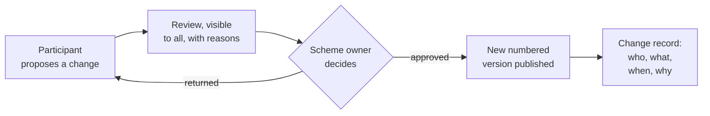

# The Contract as Data

## How ISDA rebuilt a market's paperwork

What a new payment scheme can learn from it

<div class="mt-16 text-sm opacity-80">
Ning Zhao · October 2026
</div>

<!--
- About 15 minutes, then questions.
- One case study: the International Swaps and Derivatives Association (ISDA), which maintains the contracts behind the over-the-counter derivatives market.
- Everything in this deck is public. Sources are on the last slide; the full essay has the detail and the code examples.
- Cover image: the ISDA document estate, illustration generated with Gemini.
-->

---
layout: center
class: text-center
---

# What does it mean to digitalise a body of legal documents?

<div class="grid grid-cols-3 gap-6 mt-12 text-left">

<div v-click class="p-4 rounded-lg bg-gray-100 dark:bg-gray-800">

### A better reading experience

Improves **access**.

</div>

<div v-click class="p-4 rounded-lg bg-gray-100 dark:bg-gray-800">

### A new file format

Improves **maintenance**.

</div>

<div v-click class="p-4 rounded-lg bg-gray-100 dark:bg-gray-800 border-l-8 border-teal-600">

### Neither is the whole answer

The derivatives market shows what the rest looks like.

</div>

</div>

<!--
- A web portal makes the rulebook easier to read. A new editor or format makes it easier to maintain. Both are useful.
- Neither lets a machine, or an auditor, answer: which choice was made, in which version, changed by whom and why.
- ISDA faced this question at market scale, and answered it over a decade. That is the case study.
-->

---

# A library layered by reference

An over-the-counter derivative is not one contract. It is a stack of documents, each pointing at the others.

<div class="text-sm mt-4">

| Layer | What it is | Role |
|:---|:---|:---|
| **Master Agreement** (1992, 2002) | One standard text, never edited | The fixed core: default, termination, netting |
| **Schedule** | Bilateral elections | Where two parties make the standard their own |
| **Credit Support Annex** | Collateral terms | A separate, standard module |
| **Definitions** (2006, 2021, ...) | Shared vocabulary and calculation rules | Incorporated by reference, not copied |
| **Confirmations** | The economic terms of each trade | Short, because everything else is incorporated |
| **Protocols** | Multilateral amendments by adherence | One act amends thousands of agreements |

</div>

<div v-click class="mt-6 p-3 border-l-8 border-teal-600 bg-gray-100 dark:bg-gray-800">

Standard text in one place. Negotiation confined to elections. Amendments travel by reference. **But it was built for paper.**

</div>

<!--
- Together the Master, Schedule, Confirmations and the Definitions they incorporate form a "single agreement" (Section 1(c)). That is what makes close-out netting work: an insolvent party's administrator cannot cherry-pick profitable trades. Risk is carried on the net, not the gross.
- Precedence (Section 1(b)): Schedule beats the printed Master; a Confirmation beats both, but only for its own trade.
- The weakness: the elections sit in scanned PDFs. "With which counterparties have we agreed a threshold above EUR 10 million?" still means sending lawyers to read.
-->

---

# What paper cost

<div class="grid grid-cols-[3fr_2fr] gap-8 mt-4">

<div class="text-sm">

<v-clicks>

- **2005-09-15:** the New York Fed calls in the 14 largest dealers. More than **150,000** credit derivative trades are unconfirmed.
- **2008-09-15:** Lehman Brothers. More than **900,000** transactions under some **6,000** Master Agreements. About 16% of sampled termination notices went to an old address.
- **2016 to 2022:** initial margin rules. The final phase alone: about **775** firms, **5,400** relationships, each negotiated by hand.
- **2020:** lockdown. Notices still had to be delivered physically. One weekend's delay on one portfolio: an estimated **$1 million** uncollateralised.

</v-clicks>

<div v-click class="mt-6 font-bold">

Not a technology looking for a use. Cost, delay and legal risk, paid again with every crisis.

</div>

</div>

<div>


<p class="text-xs opacity-70 mt-2 leading-tight">
Photo illustration. Original photo: <a href="https://commons.wikimedia.org/wiki/File:Lehman_Brothers-20080915.jpg" target="_blank">Robert Scoble</a>, <a href="https://creativecommons.org/licenses/by/2.0/" target="_blank">CC BY 2.0</a>, via Wikimedia Commons; cropped, toned and altered with Gemini.
</p>

</div>

</div>

<!--
- 2008 came three years to the day after the 2005 meeting.
- Lehman's London entity had moved to Canary Wharf four years earlier. ISDA and the administrators sampled 255 terminated relationships; about 16% of notices went to the old address. Across the portfolio, that could mean up to 550 notices sent to an empty building, each a potential dispute.
- Initial margin: nearly identical documents, every one negotiated by hand, against fixed regulatory dates.
- The point for executives: the cost of unstructured documents is invisible in normal times and arrives all at once in a crisis.
-->

---

# The principle

<div class="text-sm opacity-70 -mt-2">ISDA's decade of work, read as one idea in three steps</div>

<div class="grid grid-cols-[1fr_auto_1fr_auto_1fr] gap-3 mt-12 items-stretch">

<div class="relative rounded-xl border border-slate-200 bg-white/70 p-5 pt-6 shadow-sm">
  <div class="absolute -top-4 left-5 w-8 h-8 rounded-full bg-teal-600 text-white text-sm font-semibold flex items-center justify-center">1</div>
  <carbon-certificate class="text-teal-600 text-3xl" />
  <div class="text-xs uppercase tracking-widest text-teal-700 font-semibold mt-3">The text</div>
  <div class="text-2xl mt-1 mb-2 text-slate-800" style="font-family: adobe-garamond-pro, serif">Stays authoritative</div>
  <div class="text-sm">The signed legal text remains the reference. When data and text disagree, the text wins.</div>
</div>

<div class="flex items-center justify-center"><carbon-chevron-right class="text-slate-300 text-3xl" /></div>

<div v-click class="relative rounded-xl border border-slate-200 bg-white/70 p-5 pt-6 shadow-sm">
  <div class="absolute -top-4 left-5 w-8 h-8 rounded-full bg-teal-600 text-white text-sm font-semibold flex items-center justify-center">2</div>
  <carbon-tag class="text-teal-600 text-3xl" />
  <div class="text-xs uppercase tracking-widest text-teal-700 font-semibold mt-3">The choices</div>
  <div class="text-2xl mt-1 mb-2 text-slate-800" style="font-family: adobe-garamond-pro, serif">Become data</div>
  <div class="text-sm">Every choice made within the text gets an identifier, so it can be counted, compared and checked.</div>
</div>

<div class="flex items-center justify-center"><carbon-chevron-right class="text-slate-300 text-3xl" /></div>

<div v-click class="relative rounded-xl border border-slate-200 bg-white/70 p-5 pt-6 shadow-sm">
  <div class="absolute -top-4 left-5 w-8 h-8 rounded-full bg-teal-600 text-white text-sm font-semibold flex items-center justify-center">3</div>
  <carbon-data-share class="text-teal-600 text-3xl" />
  <div class="text-xs uppercase tracking-widest text-teal-700 font-semibold mt-3">The computation</div>
  <div class="text-2xl mt-1 mb-2 text-slate-800" style="font-family: adobe-garamond-pro, serif">Happens once</div>
  <div class="text-sm">Anything computable is computed once, from one shared model, instead of in every firm.</div>
</div>

</div>

<div v-click class="mt-10 flex items-center gap-4">
  <div class="h-px flex-1 bg-slate-300"></div>
  <div class="text-base italic text-slate-500">Underneath the documents, not instead of them.</div>
  <div class="h-px flex-1 bg-slate-300"></div>
</div>

<!--
- This is my reading of ISDA's decade of work, not an ISDA slogan.
- Note the order. Nothing replaces the legal text. The digitalisation happens underneath the documents, not instead of them.
-->

---

# What ISDA added, layer by layer


<div class="mt-4 text-sm text-center">

No single system replaced the paper. Each component attaches to **one layer** of the paper design and **feeds the next**.

</div>

<!--
- Clause Library and ISDA Create: choices become data.
- 2021 Definitions: versions replace supplements.
- Common Domain Model (CDM): one machine-readable model of trades and their life cycle, now open source at FINOS.
- Digital Regulatory Reporting (DRR): one shared reading of reporting rules, as executable code.
- FpML, UTI, UPI: messages and identifiers that join things up.
- Protocols and the Notices Hub: the plumbing that keeps the estate in motion.
- The next two slides take these in pairs.
-->

---

# Choices as data, versions instead of supplements

<div class="grid grid-cols-2 gap-10 mt-6">

<div v-click>

### Named choices

Most negotiated text is one of a handful of known positions, written differently each time.

The **Clause Library** names them: a stable identifier, defined wording, a few variables.

"Variant 2 of the threshold clause, EUR 10 million" instead of a drafted paragraph.

A paragraph can only be read. **A named choice can be counted, compared and checked.**

</div>

<div v-click>

### Complete versions

The 2006 Definitions grew by more than **70 supplements** over fifteen years. To know what a term meant, you had to know which were in force, and read them in order.

The **2021 Definitions** are one digital book. Each change produces a new numbered version.

**Every trade can say which version it relies on.**

</div>

</div>

<!--
- The Clause Library is the least technical step and the one that makes everything after it possible. The legal content does not change; the choice is no longer hidden in a paragraph.
- ISDA Create, the negotiation platform, started with initial margin documents: negotiation produces the signed document and the structured election data at the same time. No re-keying.
- The 2021 Interest Rate Derivatives Definitions came into use on 2021-10-04, published on ISDA's MyLibrary platform.
- It sounds like a publishing decision. It is really a decision about how a shared vocabulary is governed.
-->

---

# One shared model, one shared reading

<div class="grid grid-cols-2 gap-10 mt-6">

<div v-click>

### The Common Domain Model

A machine-readable model of what a trade is and what happens to it.

Started at ISDA, joined by ISLA and ICMA, contributed to **FINOS** (Linux Foundation) in 2023.

Released like software: numbered versions, release notes, a public repository. **Anyone may propose a change; the maintainers decide.**

</div>

<div v-click>

### Rules as code

After 2008, every regime wrote reporting rules in prose, and every bank translated them separately.

**Digital Regulatory Reporting**: working groups agree one interpretation, coded on top of the model. Live from the US (2022) to Hong Kong (2025).

**A shared reading is not an official one.** The obligation stays with each firm.

</div>

</div>

<!--
- CDM governance matters as much as the model: a model owned by one party is a product; under an open licence and open governance it is infrastructure. Open does not mean ungoverned.
- CDM 7 (announced 2026-08-14) brought more than 130 changes, including collateral agreements. Version 8 is in development; the Clause Library structure entered it in July 2026.
- DRR go-lives: CFTC 2022-12-05, Japan 2024-04-01, EU EMIR Refit 2024-04-29, UK EMIR 2024-09-30, Australia and Singapore 2024-10-21, Canada 2025-07-25, Hong Kong 2025-09-29.
- The interesting part is not the code. Competitors agreed to share one reading of the law, in a form that can be executed, tested and versioned. A consistent reading can still be consistently wrong, which is why it stays reviewable.
- Plumbing, briefly: Protocols amended millions of contracts for the end of LIBOR; the Notices Hub (launched 2025-07-15) gives one place to deliver and receive notices, with a record of when.
-->

---

# Inside the model: four questions it answers

<div class="grid grid-cols-2 gap-5 mt-6">

<div v-click class="rounded-xl border border-slate-200 bg-white/60 p-4 flex gap-4">
  <carbon-document-signed class="text-teal-600 text-2xl shrink-0 mt-1" />
  <div>
    <div class="text-xs uppercase tracking-widest text-teal-700 font-semibold">1 · What is a trade?</div>
    <div class="text-xl mt-1 mb-1" style="font-family: adobe-garamond-pro, serif">A title deed and the house's file</div>
    <div class="text-sm">The trade rarely changes. Its state keeps growing: every reset, payment and valuation.</div>
  </div>
</div>

<div v-click class="rounded-xl border border-slate-200 bg-white/60 p-4 flex gap-4">
  <carbon-search class="text-teal-600 text-2xl shrink-0 mt-1" />
  <div>
    <div class="text-xs uppercase tracking-widest text-teal-700 font-semibold">2 · What is it?</div>
    <div class="text-xl mt-1 mb-1" style="font-family: adobe-garamond-pro, serif">A birdwatcher's checklist</div>
    <div class="text-sm">Feature by feature, then the name. "Fixed-for-floating swap" is a conclusion, not a label.</div>
  </div>
</div>

<div v-click class="rounded-xl border border-slate-200 bg-white/60 p-4 flex gap-4">
  <carbon-music class="text-teal-600 text-2xl shrink-0 mt-1" />
  <div>
    <div class="text-xs uppercase tracking-widest text-teal-700 font-semibold">3 · What is an event made of?</div>
    <div class="text-xl mt-1 mb-1" style="font-family: adobe-garamond-pro, serif">Notes in a chord</div>
    <div class="text-sm">A few primitive instructions. A partial termination is a quantity change, read off the notes.</div>
  </div>
</div>

<div v-click class="rounded-xl border border-slate-200 bg-white/60 p-4 flex gap-4">
  <carbon-arrows-horizontal class="text-teal-600 text-2xl shrink-0 mt-1" />
  <div>
    <div class="text-xs uppercase tracking-widest text-teal-700 font-semibold">4 · How did LIBOR's end become data?</div>
    <div class="text-xl mt-1 mb-1" style="font-family: adobe-garamond-pro, serif">Two records of one event</div>
    <div class="text-sm">The Protocol changed the words. An index transition changes the trade. Each can be checked against the other.</div>
  </div>
</div>

</div>

<div class="mt-6 text-xs opacity-60">The model code for each example is in Appendix A.</div>

<!--
- The Common Domain Model is not the Master Agreement translated into code. It answers more basic questions afresh, and these four show how.
- 1: Trade and TradeState. Trade is the transaction (identifiers, trade date, parties, contract details). TradeState is where it stands now, with the history of resets, transfers, observations and valuations.
- 2: Qualification functions. If it is an interest rate swap, one leg fixed and one floating, not zero-coupon and not an overnight index swap, then it is what the ISDA taxonomy calls InterestRate_IRSwap_FixedFloat.
- 3: Primitive instructions. A piano has no key for C major; the chord is C, E and G. Lower the E and the same hand plays C minor. Quantity down, trade still open: partial termination. Quantity to zero and closed: a different event.
- 4: IndexTransitionInstruction carries the new index, the spread adjustment, the effective date and an optional compensating payment.
- The point for executives: a shared model makes "do we mean the same thing?" a question a machine can answer.
-->

---

# What did not change

<div class="text-sm opacity-70 -mt-2">The honest half of the story</div>

<div class="grid grid-cols-2 gap-6 mt-6 items-stretch">

<div class="rounded-xl border border-slate-200 bg-white/70 px-5 py-4 shadow-sm">
  <div class="text-xs uppercase tracking-widest text-teal-700 font-semibold mb-4 pb-2 border-b border-slate-200">The text still rules</div>
  <div v-click class="flex gap-3 mb-4">
    <carbon-certificate class="text-teal-600 text-xl shrink-0 mt-0.5" />
    <div><div class="text-lg leading-snug text-slate-800" style="font-family: adobe-garamond-pro, serif">The legal text stays authoritative</div><div class="text-sm mt-0.5 leading-snug">When the data and the signed text disagree, the text wins.</div></div>
  </div>
  <div v-click class="flex gap-3 mb-4">
    <carbon-document-view class="text-teal-600 text-xl shrink-0 mt-0.5" />
    <div><div class="text-lg leading-snug text-slate-800" style="font-family: adobe-garamond-pro, serif">People still read documents</div><div class="text-sm mt-0.5 leading-snug">Negotiators and signatories work with text, not code.</div></div>
  </div>
  <div v-click class="flex gap-3 mb-4">
    <carbon-scales class="text-teal-600 text-xl shrink-0 mt-0.5" />
    <div><div class="text-lg leading-snug text-slate-800" style="font-family: adobe-garamond-pro, serif">A lawyer decides, not the model</div><div class="text-sm mt-0.5 leading-snug">A model can record what a contract says. It cannot settle what it means.</div></div>
  </div>
</div>

<div class="rounded-xl border border-slate-200 bg-white/70 px-5 py-4 shadow-sm">
  <div class="text-xs uppercase tracking-widest text-teal-700 font-semibold mb-4 pb-2 border-b border-slate-200">The pace stayed human</div>
  <div v-click class="flex gap-3 mb-4">
    <carbon-growth class="text-teal-600 text-xl shrink-0 mt-0.5" />
    <div><div class="text-lg leading-snug text-slate-800" style="font-family: adobe-garamond-pro, serif">Adoption is gradual</div><div class="text-sm mt-0.5 leading-snug">Most banks map to the model at the edges rather than build on it.</div></div>
  </div>
  <div v-click class="flex gap-3 mb-4">
    <carbon-partnership class="text-teal-600 text-xl shrink-0 mt-0.5" />
    <div><div class="text-lg leading-snug text-slate-800" style="font-family: adobe-garamond-pro, serif">Agreement is the slow part</div><div class="text-sm mt-0.5 leading-snug">Lawyers, operations, technologists and regulators had to accept the same definitions.</div></div>
  </div>
  <div v-click class="flex gap-3 mb-4">
    <carbon-hourglass class="text-teal-600 text-xl shrink-0 mt-0.5" />
    <div><div class="text-lg leading-snug text-slate-800" style="font-family: adobe-garamond-pro, serif">It took a decade</div><div class="text-sm mt-0.5 leading-snug">Each step depended on the one before it.</div></div>
  </div>
</div>

</div>

<div v-click class="mt-6 flex items-center gap-4">
  <div class="h-px flex-1 bg-slate-300"></div>
  <div class="text-base italic text-slate-500">What worked: the layering held, so each digital step attached to an existing seam.</div>
  <div class="h-px flex-1 bg-slate-300"></div>
</div>

<!--
- This slide is what keeps the story honest. The digitalisation happened underneath the documents, not instead of them.
- No public figures suggest that negotiation platforms have replaced the negotiated Word document.
- What worked: the layering held. Because the paper design already separated standard text from elections, each digital step attached to an existing seam.
-->

---

# Three things easy to confuse

<div class="text-sm opacity-70 -mt-2">The one slide to remember</div>

<div class="grid grid-cols-[1fr_1.15fr] gap-6 mt-6 items-stretch">

<div class="flex flex-col gap-4">

<div v-click>
<div class="rounded-xl border border-slate-200 bg-white/60 px-5 py-4 opacity-80 flex gap-4">
  <carbon-view class="text-slate-400 text-2xl shrink-0 mt-1" />
  <div>
    <div class="flex items-center gap-2 text-xs uppercase tracking-widest text-slate-400 font-semibold"><carbon-close-outline /> Not digitalisation</div>
    <div class="text-xl mt-1 text-slate-600" style="font-family: adobe-garamond-pro, serif">A better reading experience</div>
    <div class="text-sm mt-1">A portal improves access. The rules underneath stay as they were.</div>
  </div>
</div>
</div>

<div v-click>
<div class="rounded-xl border border-slate-200 bg-white/60 px-5 py-4 opacity-80 flex gap-4">
  <carbon-document-export class="text-slate-400 text-2xl shrink-0 mt-1" />
  <div>
    <div class="flex items-center gap-2 text-xs uppercase tracking-widest text-slate-400 font-semibold"><carbon-close-outline /> Not digitalisation</div>
    <div class="text-xl mt-1 text-slate-600" style="font-family: adobe-garamond-pro, serif">A new file format</div>
    <div class="text-sm mt-1">A new editor improves maintenance. It does not say what changed, or why.</div>
  </div>
</div>
</div>

</div>

<div v-click class="rounded-xl border-l-8 border-teal-600 bg-teal-50 dark:bg-teal-900/20 px-6 py-5 shadow-sm flex flex-col">
  <div class="flex items-center gap-2 text-xs uppercase tracking-widest text-teal-700 font-semibold"><carbon-checkmark-outline /> Digitalisation starts when</div>
  <div class="flex gap-4 mt-5">
    <carbon-recently-viewed class="text-teal-600 text-2xl shrink-0 mt-1" />
    <div><div class="text-xl text-slate-800" style="font-family: adobe-garamond-pro, serif">Every change can be traced</div><div class="text-sm mt-1">Who changed what, when, and why.</div></div>
  </div>
  <div class="flex gap-4 mt-5">
    <carbon-version class="text-teal-600 text-2xl shrink-0 mt-1" />
    <div><div class="text-xl text-slate-800" style="font-family: adobe-garamond-pro, serif">Every reader can name the version</div><div class="text-sm mt-1">The exact text they relied on, at the time they relied on it.</div></div>
  </div>
</div>

</div>

<div v-click class="mt-8 flex items-center gap-4">
  <div class="h-px flex-1 bg-slate-300"></div>
  <div class="text-base italic text-slate-500 text-center max-w-2xl">The first two can be added at any time. The third cannot: a change history only exists from the day you start keeping it.</div>
  <div class="h-px flex-1 bg-slate-300"></div>
</div>

<!--
- This is the one slide to remember.
- A portal or a new editor can be bought next year. The history of how the rules came to be cannot be reconstructed next year. Every month without it is a month that will stay undocumented.
-->

---

# Lessons for complex programmes

<div class="text-sm opacity-70 -mt-2">Seven lessons from ISDA, in three groups</div>

<div class="grid grid-cols-3 gap-5 mt-6 items-stretch">

<div class="rounded-xl border border-slate-200 bg-white/70 px-4 py-4 shadow-sm">
  <div class="text-xs uppercase tracking-widest text-teal-700 font-semibold mb-3 pb-2 border-b border-slate-200">Structure</div>
  <div class="flex gap-3 mb-3">
    <carbon-cut class="text-teal-600 text-lg shrink-0 mt-0.5" />
    <div><div class="text-base leading-snug text-slate-800" style="font-family: adobe-garamond-pro, serif"><span class="text-teal-600">1.</span> Find the seams before building</div><div class="text-xs mt-0.5 leading-snug">Digitalisation followed the existing split between standard text, elections and vocabulary.</div></div>
  </div>
  <div class="flex gap-3 mb-3">
    <carbon-list-checked class="text-teal-600 text-lg shrink-0 mt-0.5" />
    <div><div class="text-base leading-snug text-slate-800" style="font-family: adobe-garamond-pro, serif"><span class="text-teal-600">2.</span> Standardise before you digitalise</div><div class="text-xs mt-0.5 leading-snug">The most useful step was the least technical: deciding what the options are.</div></div>
  </div>
  <div class="flex gap-3 mb-3">
    <carbon-version class="text-teal-600 text-lg shrink-0 mt-0.5" />
    <div><div class="text-base leading-snug text-slate-800" style="font-family: adobe-garamond-pro, serif"><span class="text-teal-600">3.</span> Versions beat supplements</div><div class="text-xs mt-0.5 leading-snug">Released versions with a known state are easier to cite, test and govern.</div></div>
  </div>
</div>

<div v-click class="rounded-xl border border-slate-200 bg-white/70 px-4 py-4 shadow-sm">
  <div class="text-xs uppercase tracking-widest text-teal-700 font-semibold mb-3 pb-2 border-b border-slate-200">Governance</div>
  <div class="flex gap-3 mb-3">
    <carbon-partnership class="text-teal-600 text-lg shrink-0 mt-0.5" />
    <div><div class="text-base leading-snug text-slate-800" style="font-family: adobe-garamond-pro, serif"><span class="text-teal-600">4.</span> Open governance helps mutualisation</div><div class="text-xs mt-0.5 leading-snug">Competitors contribute to a model they do not have to trust one party with.</div></div>
  </div>
  <div class="flex gap-3 mb-3">
    <carbon-rule class="text-teal-600 text-lg shrink-0 mt-0.5" />
    <div><div class="text-base leading-snug text-slate-800" style="font-family: adobe-garamond-pro, serif"><span class="text-teal-600">5.</span> Agree the interpretation once</div><div class="text-xs mt-0.5 leading-snug">One executable reading, governed openly, beats many private ones.</div></div>
  </div>
</div>

<div v-click class="rounded-xl border border-slate-200 bg-white/70 px-4 py-4 shadow-sm">
  <div class="text-xs uppercase tracking-widest text-teal-700 font-semibold mb-3 pb-2 border-b border-slate-200">Operations</div>
  <div class="flex gap-3 mb-3">
    <carbon-connect class="text-teal-600 text-lg shrink-0 mt-0.5" />
    <div><div class="text-base leading-snug text-slate-800" style="font-family: adobe-garamond-pro, serif"><span class="text-teal-600">6.</span> Do not forget the plumbing</div><div class="text-xs mt-0.5 leading-snug">Notices, amendments and adherence are dull, and essential.</div></div>
  </div>
  <div class="flex gap-3 mb-3">
    <carbon-hourglass class="text-teal-600 text-lg shrink-0 mt-0.5" />
    <div><div class="text-base leading-snug text-slate-800" style="font-family: adobe-garamond-pro, serif"><span class="text-teal-600">7.</span> Expect it to take a decade</div><div class="text-xs mt-0.5 leading-snug">Unless you start with the structure in place.</div></div>
  </div>
</div>

</div>

<!--
- Lessons 1 and 2 are organisational, not technical. They cost meeting time, not software.
- Lesson 7 is the bridge to the next slide: ISDA needed a decade because it started from decades of signed paper.
-->

---

# A new scheme has two advantages ISDA never had

<div class="grid grid-cols-2 gap-10 mt-8">

<div v-click class="p-5 rounded-lg bg-gray-100 dark:bg-gray-800">

### It is greenfield

No decades of signed paper to extract identifiers from.

- Named choices from the **first draft**
- Numbered versions from the **first release**
- A change record, with reasons, from **day one**

</div>

<div v-click class="p-5 rounded-lg bg-gray-100 dark:bg-gray-800">

### It has a single scheme owner

No need to convene a market to agree on a shared model.

- **One** rulebook, **one** set of standards
- Participants **propose** changes
- The scheme owner **decides**

</div>

</div>

<div v-click class="mt-8">

Any scheme with a rulebook, technical standards and obligations for many participants is **the same kind of layered library** ISDA started from.

</div>

<!--
- The question is not whether to digitalise eventually. It is whether to start with structure or to extract it later at ISDA's cost.
-->

---

# The human gate stays where it belongs



<div class="grid grid-cols-3 gap-6 mt-8 text-sm text-center">

<div v-click>

**People decide.** Approval is a named person's act, with the accountability that a scheme owner owes to its users.

</div>

<div v-click>

**The system records.** Who proposed, who reviewed, who approved, and why, kept for good.

</div>

<div v-click>

**Then it takes effect.** Nothing changes until the decision is made. Publication follows the decision, never the reverse.

</div>

</div>

<!--
- This is the CDM's governance at FINOS, applied to a scheme: open proposals, a maintainer who decides, a release that follows the decision.
- Automation here does the clerical part: numbering, publishing, keeping the record, generating the change log. It does not decide anything.
- For a central bank this matters more than anywhere: the decision and its accountability stay with the institution.
-->

---

# The decision worth making deliberately

<div class="grid grid-cols-[1fr_auto_1.25fr] gap-5 mt-8 items-stretch">

<div class="rounded-xl border border-slate-200 bg-white/60 p-5 opacity-80">
  <div class="text-xs uppercase tracking-widest text-slate-400 font-semibold">Path A</div>
  <div class="text-2xl mt-1 mb-4 text-slate-600" style="font-family: adobe-garamond-pro, serif">Paper first, digitalise later</div>
  <div class="flex items-start gap-3 mb-3"><carbon-document class="text-slate-400 text-lg shrink-0 mt-0.5" /><span>Choices stay hidden in paragraphs</span></div>
  <div class="flex items-start gap-3 mb-3"><carbon-search class="text-slate-400 text-lg shrink-0 mt-0.5" /><span>Structure extracted afterwards, document by document</span></div>
  <div class="flex items-start gap-3"><carbon-hourglass class="text-slate-400 text-lg shrink-0 mt-0.5" /><span>ISDA's cost and pace: about a decade</span></div>
</div>

<div class="flex items-center">
  <div class="w-10 h-10 rounded-full bg-slate-100 border border-slate-200 flex items-center justify-center text-sm text-slate-500">or</div>
</div>

<div v-click class="rounded-xl border-l-8 border-teal-600 bg-teal-50 dark:bg-teal-900/20 p-5 shadow-sm">
  <div class="text-xs uppercase tracking-widest text-teal-700 font-semibold">Path B</div>
  <div class="text-2xl mt-1 mb-4 text-slate-800" style="font-family: adobe-garamond-pro, serif">Structure from day one</div>
  <div class="flex items-start gap-3 mb-3"><carbon-tag class="text-teal-600 text-lg shrink-0 mt-0.5" /><span><b>Named choices:</b> every option has an identifier</span></div>
  <div class="flex items-start gap-3 mb-3"><carbon-version class="text-teal-600 text-lg shrink-0 mt-0.5" /><span><b>Versioned texts:</b> every release complete, dated, citable</span></div>
  <div class="flex items-start gap-3"><carbon-recently-viewed class="text-teal-600 text-lg shrink-0 mt-0.5" /><span><b>A record of every change:</b> who, what, when and why</span></div>
</div>

</div>

<div v-click class="mt-10 flex items-center gap-4">
  <div class="h-px flex-1 bg-slate-300"></div>
  <div class="text-base italic text-slate-500 max-w-2xl text-center">ISDA did not set out to turn contracts into data. It set out to make a market's paperwork manageable, one step at a time. The data came as a consequence.</div>
  <div class="h-px flex-1 bg-slate-300"></div>
</div>

<!--
- Three low-cost first steps, none of which requires new technology:
  1. Name the choices: where the rulebook offers options, give each option an identifier.
  2. Number the releases: every published version complete, dated, citable.
  3. Keep the record: every change with its author, date and reason, starting now.
- The tooling question comes after, and it is the easy one.
-->

---

# Sources and further reading

<div class="text-sm mt-6 space-y-3">

- **The full essay:** [The Contract as Data: How ISDA Rebuilt a Market's Paperwork](https://code-and-civilisation.vercel.app/posts/the-contract-as-data-isda/)
- **ISDA:** [isda.org](https://www.isda.org/) · [Protocols](https://www.isda.org/protocols/) · [Notices Hub](https://www.isda.org/isda-solutions-infohub/isda-notices-hub/) · [Digital Regulatory Reporting](https://www.isda.org/isda-solutions-infohub/isda-digital-regulatory-reporting/) · [MyLibrary](https://www.isda.org/isda-solutions-infohub/mylibrary/)
- **Common Domain Model:** [cdm.finos.org](https://cdm.finos.org/) · [github.com/finos/common-domain-model](https://github.com/finos/common-domain-model)
- **FpML:** [fpml.org](https://www.fpml.org/)
- **Élan**, an open workbench applying these principles to a scheme rulebook: [github.com/nnworkspace/elan](https://github.com/nnworkspace/elan)

</div>

<div class="mt-10 text-xs opacity-70">

Cover illustration generated with Gemini. Lehman photo illustration based on Robert Scoble's photo, CC BY 2.0, via Wikimedia Commons.

</div>

---
layout: center
class: text-center
---

# Appendix A

The four model examples, as code

<div class="mt-4 text-sm opacity-70">Taken from the Common Domain Model repository at FINOS. Descriptions and some annotations omitted; shortened where marked.</div>

---

# Example 1: a trade, and the state it is in

<div class="grid grid-cols-[3fr_2fr] gap-8 mt-4">

<div class="text-xs">

```text
type Trade extends TradableProduct:
    [metadata key]
    tradeIdentifier TradeIdentifier (1..*)
    tradeDate date (1..1)
    tradeTime TimeZone (0..1)
    party Party (0..*)
    partyRole PartyRole (0..*)
    executionDetails ExecutionDetails (0..1)
    contractDetails ContractDetails (0..1)
    collateral Collateral (0..1)

type TradeState:
    [metadata key]
    [rootType]
    trade Trade (1..1)
    state State (0..1)
    resetHistory Reset (0..*)
    transferHistory TransferState (0..*)
    observationHistory ObservationEvent (0..*)
    valuationHistory Valuation (0..*)
```

</div>

<div class="text-sm">

**Trade** is the transaction: at least one identifier, exactly one trade date, the parties and their roles.

**TradeState** is where it stands now, with every reset, transfer, observation and valuation so far.

<div class="mt-4 p-3 rounded-lg bg-teal-50 border-l-4 border-teal-600">

The title deed and the house's file: the deed rarely changes, the file keeps growing.

</div>

<div class="mt-4 text-xs opacity-70">(1..1) exactly one · (0..1) optional · (1..*) at least one · (0..*) any number</div>

</div>

</div>

---

# Example 2: recognising an interest rate swap

<div class="grid grid-cols-[3fr_2fr] gap-8 mt-4">

<div class="text-xs">

```text
func Qualify_InterestRate_IRSwap_FixedFloat:
    [qualification Product]
    inputs:
        economicTerms EconomicTerms (1..1)
    output:
        is_product boolean (1..1)

    set is_product:
        Qualify_BaseProduct_IRSwap(economicTerms) = True
            and Qualify_SubProduct_FixedFloat(economicTerms) = True
            and Qualify_Transaction_ZeroCoupon(economicTerms) = False
            and Qualify_Transaction_OIS(economicTerms) = False
```

</div>

<div class="text-sm">

If it is an interest rate swap, one leg is fixed and the other floating, it is not zero-coupon and not an overnight index swap, then it is **InterestRate_IRSwap_FixedFloat** in the ISDA product taxonomy.

<div class="mt-4 p-3 rounded-lg bg-teal-50 border-l-4 border-teal-600">

A birdwatcher's checklist: plumage, beak, feet, then the name.

</div>

</div>

</div>

---

# Example 3: an event built from primitives

<div class="grid grid-cols-[3fr_2fr] gap-8 mt-4">

<div class="text-xs">

```text
type PrimitiveInstruction:
    // abridged: 13 optional instructions, among them
    contractFormation ContractFormationInstruction (0..1)
    quantityChange QuantityChangeInstruction (0..1)
    transfer TransferInstruction (0..1)
    indexTransition IndexTransitionInstruction (0..1)
    ...

func Qualify_PartialTermination:
    [qualification BusinessEvent]
    set is_event:
        businessEvent -> intent is absent
            and (primitiveInstruction -> quantityChange only exists
                or (primitiveInstruction -> quantityChange,
                    primitiveInstruction -> transfer) only exists)
            and (QuantityDecreased(...) = True)
            and businessEvent -> after -> state -> closedState is absent
```

</div>

<div class="text-sm">

Only a quantity change, or a quantity change plus a cash transfer; the quantity went down; the trade is still open. Then it is a **partial termination**.

Down to zero and closed: a different event.

<div class="mt-4 p-3 rounded-lg bg-teal-50 border-l-4 border-teal-600">

Notes in a chord: C, E and G make C major. Lower the E and the same hand plays C minor.

</div>

</div>

</div>

---

# Example 4: the end of LIBOR, in data

<div class="grid grid-cols-[3fr_2fr] gap-8 mt-4">

<div class="text-xs">

```text
type IndexTransitionInstruction:
    priceQuantity PriceQuantity (1..*)
    effectiveDate date (1..1)
    cashTransfer Transfer (0..1)

// from the qualification function for this event:
    set is_event:
        businessEvent -> intent = EventIntentEnum -> IndexTransition
            and floatingRateIndexChanged = True
            and adjustmentSpreadAdded = True
```

</div>

<div class="text-sm">

For each leg: the new floating rate index and the spread adjustment, the effective date and, where agreed, a compensating payment.

The rule: the intent is an index transition, the index has actually changed, and any spread present is not zero.

<div class="mt-4 p-3 rounded-lg bg-teal-50 border-l-4 border-teal-600">

The Protocol changed the words of the contract. The index transition changes the state of the trade. Two records of one event.

</div>

</div>

</div>

---
layout: center
class: text-center
---

# Appendix B

One trade, end to end

<div class="mt-4 text-sm opacity-70">A fictional swap, followed through every layer of the document library</div>

---

# One trade, seven layers

<div class="text-sm opacity-70 -mt-2">Bank A and Pension Fund B agree a five-year euro interest rate swap</div>

<div class="grid grid-cols-7 gap-2 mt-8">

<div class="rounded-lg border border-slate-200 bg-white/70 px-2 py-3 text-center shadow-sm">
  <carbon-document-signed class="text-teal-600 text-2xl mx-auto" />
  <div class="text-sm mt-2 leading-tight text-slate-800" style="font-family: adobe-garamond-pro, serif">2002 Master Agreement</div>
  <div class="text-[10px] mt-1 opacity-70 leading-tight">Signed 2019, printed form</div>
</div>
<div class="rounded-lg border border-slate-200 bg-white/70 px-2 py-3 text-center shadow-sm">
  <carbon-policy class="text-teal-600 text-2xl mx-auto" />
  <div class="text-sm mt-2 leading-tight text-slate-800" style="font-family: adobe-garamond-pro, serif">Schedule</div>
  <div class="text-[10px] mt-1 opacity-70 leading-tight">Their elections</div>
</div>
<div class="rounded-lg border border-slate-200 bg-white/70 px-2 py-3 text-center shadow-sm">
  <carbon-money class="text-teal-600 text-2xl mx-auto" />
  <div class="text-sm mt-2 leading-tight text-slate-800" style="font-family: adobe-garamond-pro, serif">VM Credit Support Annex</div>
  <div class="text-[10px] mt-1 opacity-70 leading-tight">Collateral terms</div>
</div>
<div class="rounded-lg border border-slate-200 bg-white/70 px-2 py-3 text-center shadow-sm">
  <carbon-book class="text-teal-600 text-2xl mx-auto" />
  <div class="text-sm mt-2 leading-tight text-slate-800" style="font-family: adobe-garamond-pro, serif">2021 Definitions</div>
  <div class="text-[10px] mt-1 opacity-70 leading-tight">Shared vocabulary, versioned</div>
</div>
<div class="rounded-lg border border-slate-200 bg-white/70 px-2 py-3 text-center shadow-sm">
  <carbon-email class="text-teal-600 text-2xl mx-auto" />
  <div class="text-sm mt-2 leading-tight text-slate-800" style="font-family: adobe-garamond-pro, serif">Confirmation</div>
  <div class="text-[10px] mt-1 opacity-70 leading-tight">This one trade</div>
</div>
<div class="rounded-lg border border-slate-200 bg-white/70 px-2 py-3 text-center shadow-sm">
  <carbon-data-structured class="text-teal-600 text-2xl mx-auto" />
  <div class="text-sm mt-2 leading-tight text-slate-800" style="font-family: adobe-garamond-pro, serif">CDM record</div>
  <div class="text-[10px] mt-1 opacity-70 leading-tight">The trade as data</div>
</div>
<div class="rounded-lg border border-slate-200 bg-white/70 px-2 py-3 text-center shadow-sm">
  <carbon-report class="text-teal-600 text-2xl mx-auto" />
  <div class="text-sm mt-2 leading-tight text-slate-800" style="font-family: adobe-garamond-pro, serif">Regulatory report</div>
  <div class="text-[10px] mt-1 opacity-70 leading-tight">Generated from the record</div>
</div>

</div>

<div class="grid grid-cols-7 gap-2 mt-2 text-[10px] text-center uppercase tracking-widest">
  <div class="col-span-5 border-t-2 border-slate-300 pt-2 text-slate-500">Legal documents: the text that binds</div>
  <div class="col-span-2 border-t-2 border-teal-600 pt-2 text-teal-700">Data: derived from the text</div>
</div>

<div class="mt-8 grid grid-cols-3 gap-5 text-sm">
  <div class="flex gap-3"><carbon-calendar class="text-teal-600 text-xl shrink-0" /><div><b>Signed once:</b> Master Agreement, Schedule and CSA, years before the trade.</div></div>
  <div class="flex gap-3"><carbon-book class="text-teal-600 text-xl shrink-0" /><div><b>Referenced:</b> the Definitions are never signed, only named, with a version.</div></div>
  <div class="flex gap-3"><carbon-email class="text-teal-600 text-xl shrink-0" /><div><b>Per trade:</b> only the Confirmation is new, and it is short.</div></div>
</div>

<div class="abs-bl ml-14 mb-3 text-[10px] opacity-50">Illustrative. Fictional parties and figures; document wording paraphrased, not ISDA text.</div>

<!--
- The parties, dates and figures on the next slides are invented. The structure follows the 2002 ISDA Master Agreement, the 2016 VM Credit Support Annex (English law) and the 2021 ISDA Interest Rate Derivatives Definitions.
- The document wording is paraphrased. ISDA's forms are copyrighted and available from ISDA.
- Read the chain left to right: each document points at the ones before it.
-->

---

# The trade in one sentence

<div class="text-sm opacity-70 -mt-2">What the two parties agree on the phone, or on a trading platform</div>

<div class="grid grid-cols-[3fr_2fr] gap-8 mt-5 items-start">

<div>

<div class="rounded-xl border-l-8 border-teal-600 bg-teal-50 dark:bg-teal-900/20 px-6 py-5 shadow-sm">
  <div class="text-xs uppercase tracking-widest text-teal-700 font-semibold">2026-10-15, 10:42 CET</div>
  <div class="text-2xl mt-2 leading-snug text-slate-800" style="font-family: adobe-garamond-pro, serif">Bank A pays a fixed 2.10% a year on EUR 50 million to Pension Fund B for five years. Fund B pays €STR, compounded daily, on the same amount.</div>
</div>

<div class="grid grid-cols-2 gap-4 mt-5 text-sm">
  <div class="rounded-lg border border-slate-200 bg-white/70 p-3 flex gap-3"><carbon-building class="text-teal-600 text-xl shrink-0" /><div><b>Bank A</b>, Frankfurt. A dealer. Pays fixed.</div></div>
  <div class="rounded-lg border border-slate-200 bg-white/70 p-3 flex gap-3"><carbon-piggy-bank class="text-teal-600 text-xl shrink-0" /><div><b>Pension Fund B</b>, Amsterdam. Receives fixed to match its long-term pension liabilities.</div></div>
</div>

</div>

<div>

<div class="flex gap-3 mb-4">
  <carbon-help class="text-teal-600 text-xl shrink-0 mt-0.5" />
  <div><div class="text-lg leading-snug text-slate-800" style="font-family: adobe-garamond-pro, serif">Why a pension fund does this</div><div class="text-sm mt-0.5 leading-snug">Its promises to pensioners are fixed. Receiving a fixed rate protects it if interest rates fall.</div></div>
</div><div class="flex gap-3 mb-4">
  <carbon-document-signed class="text-teal-600 text-xl shrink-0 mt-0.5" />
  <div><div class="text-lg leading-snug text-slate-800" style="font-family: adobe-garamond-pro, serif">What is already in place</div><div class="text-sm mt-0.5 leading-snug">They signed a Master Agreement, a Schedule and a CSA in 2019. Nothing needs negotiating today except this trade.</div></div>
</div><div class="flex gap-3 mb-4">
  <carbon-email class="text-teal-600 text-xl shrink-0 mt-0.5" />
  <div><div class="text-lg leading-snug text-slate-800" style="font-family: adobe-garamond-pro, serif">What happens next</div><div class="text-sm mt-0.5 leading-snug">Within the hour, Bank A sends a Confirmation. Everything else on it is incorporated by reference.</div></div>
</div>

</div>

</div>

<div class="abs-bl ml-14 mb-3 text-[10px] opacity-50">Illustrative. Fictional parties and figures; document wording paraphrased, not ISDA text.</div>

<!--
- €STR is the euro short-term rate published by the ECB. The 2021 Definitions name it as a Floating Rate Option: EUR-EuroSTR-OIS Compound.
- Annual payments on both legs, Actual/360, is the usual convention for a euro overnight index swap.
-->

---

# Layer 1 and 2: Master Agreement and Schedule

<div class="text-sm opacity-70 -mt-2">Signed 2019-03-01. The printed form is never edited; the Schedule holds their choices</div>

<div class="grid grid-cols-2 gap-6 mt-5 items-start">

<div>

<div class="rounded-lg border border-slate-300 bg-white shadow-md overflow-hidden">
  <div class="px-4 py-2 bg-slate-100 border-b border-slate-300 flex items-baseline justify-between">
    <div class="text-lg text-slate-800" style="font-family: adobe-garamond-pro, serif">2002 ISDA Master Agreement</div>
    <div class="text-[10px] uppercase tracking-widest text-slate-500">Printed form, unchanged</div>
  </div>
  <div class="px-4 py-2 text-xs">
    <div class="flex gap-3 py-1 border-b border-dashed border-slate-200 last:border-0"><div class="w-2/5 shrink-0 text-slate-500">Section 1(c)</div><div class="text-slate-800">All transactions form a single agreement</div></div>
    <div class="flex gap-3 py-1 border-b border-dashed border-slate-200 last:border-0"><div class="w-2/5 shrink-0 text-slate-500">Section 2(c)</div><div class="text-slate-800">Same-day, same-currency payments are netted</div></div>
    <div class="flex gap-3 py-1 border-b border-dashed border-slate-200 last:border-0"><div class="w-2/5 shrink-0 text-slate-500">Section 5</div><div class="text-slate-800">Events of Default and Termination Events</div></div>
    <div class="flex gap-3 py-1 border-b border-dashed border-slate-200 last:border-0"><div class="w-2/5 shrink-0 text-slate-500">Section 6</div><div class="text-slate-800">Early termination and the Close-out Amount</div></div>
    <div class="flex gap-3 py-1 border-b border-dashed border-slate-200 last:border-0"><div class="w-2/5 shrink-0 text-slate-500">Section 12</div><div class="text-slate-800">How notices are delivered</div></div>
  </div>
</div>

</div>

<div>

<div class="rounded-lg border border-slate-300 bg-white shadow-md overflow-hidden">
  <div class="px-4 py-2 bg-slate-100 border-b border-slate-300 flex items-baseline justify-between">
    <div class="text-lg text-slate-800" style="font-family: adobe-garamond-pro, serif">Schedule</div>
    <div class="text-[10px] uppercase tracking-widest text-slate-500">Their elections</div>
  </div>
  <div class="px-4 py-2 text-xs">
    <div class="flex gap-3 py-1 border-b border-dashed border-slate-200 last:border-0"><div class="w-2/5 shrink-0 text-slate-500">Cross Default</div><div class="text-slate-800">Applies to both. Threshold: Bank A, 2% of shareholders' equity; Fund B, EUR 10 million</div></div>
    <div class="flex gap-3 py-1 border-b border-dashed border-slate-200 last:border-0"><div class="w-2/5 shrink-0 text-slate-500">Automatic Early Termination</div><div class="text-slate-800">Not applicable</div></div>
    <div class="flex gap-3 py-1 border-b border-dashed border-slate-200 last:border-0"><div class="w-2/5 shrink-0 text-slate-500">Termination Currency</div><div class="text-slate-800">EUR</div></div>
    <div class="flex gap-3 py-1 border-b border-dashed border-slate-200 last:border-0"><div class="w-2/5 shrink-0 text-slate-500">Additional Termination Event</div><div class="text-slate-800">Fund B: net asset value falls by more than 25% within 12 months</div></div>
    <div class="flex gap-3 py-1 border-b border-dashed border-slate-200 last:border-0"><div class="w-2/5 shrink-0 text-slate-500">Governing law</div><div class="text-slate-800">English law</div></div>
    <div class="flex gap-3 py-1 border-b border-dashed border-slate-200 last:border-0"><div class="w-2/5 shrink-0 text-slate-500">Notices</div><div class="text-slate-800">Addresses, plus delivery through the ISDA Notices Hub</div></div>
  </div>
</div>

</div>

</div>

<div class="grid grid-cols-3 gap-6 mt-5">
<div class="flex gap-3">
  <carbon-policy class="text-teal-600 text-xl shrink-0 mt-0.5" />
  <div><div class="text-base leading-snug text-slate-800" style="font-family: adobe-garamond-pro, serif">The printed form is the same for everyone</div><div class="text-xs mt-0.5 leading-snug">Thousands of firms sign the identical 2002 text. That is what makes it a standard.</div></div>
</div>
<div class="flex gap-3">
  <carbon-settings-adjust class="text-teal-600 text-xl shrink-0 mt-0.5" />
  <div><div class="text-base leading-snug text-slate-800" style="font-family: adobe-garamond-pro, serif">The Schedule is where they differ</div><div class="text-xs mt-0.5 leading-snug">Every line is a choice from a small set of well-known positions. This is what the Clause Library later names.</div></div>
</div>
<div class="flex gap-3">
  <carbon-warning-alt class="text-teal-600 text-xl shrink-0 mt-0.5" />
  <div><div class="text-base leading-snug text-slate-800" style="font-family: adobe-garamond-pro, serif">A choice that matters later</div><div class="text-xs mt-0.5 leading-snug">The fund-specific termination event lets Bank A exit if Fund B shrinks fast.</div></div>
</div>
</div>

<div class="abs-bl ml-14 mb-3 text-[10px] opacity-50">Illustrative. Fictional parties and figures; document wording paraphrased, not ISDA text.</div>

<!--
- Schedule Part 1 holds the termination-related elections (specified entities, cross default, automatic early termination, termination currency, additional termination events). Part 2 tax representations, Part 3 documents to deliver, Part 4 miscellaneous (notices, governing law, calculation agent), Part 5 other provisions.
- A NAV trigger is a common additional termination event for funds.
- Under English law, the 2016 VM CSA forms part of the Schedule.
-->

---

# Layer 3: the Credit Support Annex

<div class="text-sm opacity-70 -mt-2">Variation margin: collateral moves every day to cover the swap's current value</div>

<div class="grid grid-cols-[3fr_2fr] gap-8 mt-5 items-start">

<div>

<div class="rounded-lg border border-slate-300 bg-white shadow-md overflow-hidden">
  <div class="px-4 py-2 bg-slate-100 border-b border-slate-300 flex items-baseline justify-between">
    <div class="text-lg text-slate-800" style="font-family: adobe-garamond-pro, serif">2016 Credit Support Annex for Variation Margin</div>
    <div class="text-[10px] uppercase tracking-widest text-slate-500">English law, title transfer</div>
  </div>
  <div class="px-4 py-2 text-xs">
    <div class="flex gap-3 py-1 border-b border-dashed border-slate-200 last:border-0"><div class="w-2/5 shrink-0 text-slate-500">Base Currency</div><div class="text-slate-800">EUR</div></div>
    <div class="flex gap-3 py-1 border-b border-dashed border-slate-200 last:border-0"><div class="w-2/5 shrink-0 text-slate-500">Eligible Credit Support</div><div class="text-slate-800">EUR cash (100%); German government bonds up to 10 years (98%)</div></div>
    <div class="flex gap-3 py-1 border-b border-dashed border-slate-200 last:border-0"><div class="w-2/5 shrink-0 text-slate-500">Threshold</div><div class="text-slate-800">None: margin from the first euro</div></div>
    <div class="flex gap-3 py-1 border-b border-dashed border-slate-200 last:border-0"><div class="w-2/5 shrink-0 text-slate-500">Minimum Transfer Amount</div><div class="text-slate-800">EUR 250,000</div></div>
    <div class="flex gap-3 py-1 border-b border-dashed border-slate-200 last:border-0"><div class="w-2/5 shrink-0 text-slate-500">Rounding</div><div class="text-slate-800">EUR 10,000</div></div>
    <div class="flex gap-3 py-1 border-b border-dashed border-slate-200 last:border-0"><div class="w-2/5 shrink-0 text-slate-500">Valuation Agent</div><div class="text-slate-800">The party making the demand</div></div>
    <div class="flex gap-3 py-1 border-b border-dashed border-slate-200 last:border-0"><div class="w-2/5 shrink-0 text-slate-500">Valuation Date</div><div class="text-slate-800">Every Local Business Day</div></div>
    <div class="flex gap-3 py-1 border-b border-dashed border-slate-200 last:border-0"><div class="w-2/5 shrink-0 text-slate-500">Interest on cash</div><div class="text-slate-800">€STR</div></div>
  </div>
</div>

</div>

<div>

<div class="flex gap-3 mb-4">
  <carbon-renew class="text-teal-600 text-xl shrink-0 mt-0.5" />
  <div><div class="text-lg leading-snug text-slate-800" style="font-family: adobe-garamond-pro, serif">Every business day</div><div class="text-sm mt-0.5 leading-snug">Each side values the swap. If it owes more than the minimum, it transfers collateral.</div></div>
</div><div class="flex gap-3 mb-4">
  <carbon-scales class="text-teal-600 text-xl shrink-0 mt-0.5" />
  <div><div class="text-lg leading-snug text-slate-800" style="font-family: adobe-garamond-pro, serif">Why there is no threshold</div><div class="text-sm mt-0.5 leading-snug">EU margin rules require variation margin from the first euro for firms in scope.</div></div>
</div><div class="flex gap-3 mb-4">
  <carbon-tag class="text-teal-600 text-xl shrink-0 mt-0.5" />
  <div><div class="text-lg leading-snug text-slate-800" style="font-family: adobe-garamond-pro, serif">Again, elections</div><div class="text-sm mt-0.5 leading-snug">The CSA is a standard text with a page of choices. The haircut (98%) is one of them.</div></div>
</div>

</div>

</div>

<div class="abs-bl ml-14 mb-3 text-[10px] opacity-50">Illustrative. Fictional parties and figures; document wording paraphrased, not ISDA text.</div>

<!--
- Title transfer: the collateral changes owner, and the obligation is to return equivalent collateral.
- Initial margin would need a separate document with a custodian; it is left out here to keep the example small.
- The figures are illustrative.
-->

---

# Layer 4: the Definitions

<div class="text-sm opacity-70 -mt-2">Never signed, only named. One line in the Confirmation imports a whole book</div>

<div class="grid grid-cols-[3fr_2fr] gap-8 mt-5 items-start">

<div>

<div class="rounded-lg border border-slate-300 bg-white shadow-md overflow-hidden">
  <div class="px-4 py-2 bg-slate-100 border-b border-slate-300 flex items-baseline justify-between">
    <div class="text-lg text-slate-800" style="font-family: adobe-garamond-pro, serif">2021 ISDA Interest Rate Derivatives Definitions</div>
    <div class="text-[10px] uppercase tracking-widest text-slate-500">Digital, versioned</div>
  </div>
  <div class="px-4 py-3 text-xs space-y-3">
    <div><div class="text-slate-500">Floating Rate Option</div><div class="text-slate-800"><b>EUR-EuroSTR-OIS Compound</b>: €STR for each day of the period, compounded, as set out in the Floating Rate Matrix</div></div>
    <div><div class="text-slate-500">Day Count Fraction</div><div class="text-slate-800"><b>Actual/360</b>: actual days in the period divided by 360</div></div>
    <div><div class="text-slate-500">Business Day</div><div class="text-slate-800"><b>TARGET</b>: a day the euro payment system is open</div></div>
    <div><div class="text-slate-500">If €STR stops</div><div class="text-slate-800">A fallback rate applies, set out in the Definitions themselves</div></div>
  </div>
</div>

</div>

<div>

<div class="flex gap-3 mb-4">
  <carbon-book class="text-teal-600 text-xl shrink-0 mt-0.5" />
  <div><div class="text-lg leading-snug text-slate-800" style="font-family: adobe-garamond-pro, serif">A shared vocabulary</div><div class="text-sm mt-0.5 leading-snug">"EUR-EuroSTR-OIS Compound" means exactly the same thing in every trade in the market.</div></div>
</div><div class="flex gap-3 mb-4">
  <carbon-version class="text-teal-600 text-xl shrink-0 mt-0.5" />
  <div><div class="text-lg leading-snug text-slate-800" style="font-family: adobe-garamond-pro, serif">Versions, not supplements</div><div class="text-sm mt-0.5 leading-snug">The Definitions are updated as numbered versions. A trade can name the one it uses.</div></div>
</div><div class="flex gap-3 mb-4">
  <carbon-renew class="text-teal-600 text-xl shrink-0 mt-0.5" />
  <div><div class="text-lg leading-snug text-slate-800" style="font-family: adobe-garamond-pro, serif">Fallbacks built in</div><div class="text-sm mt-0.5 leading-snug">The answer to "what if the rate disappears?" is already in the book, learned from LIBOR.</div></div>
</div>

</div>

</div>

<div class="abs-bl ml-14 mb-3 text-[10px] opacity-50">Illustrative. Fictional parties and figures; document wording paraphrased, not ISDA text.</div>

<!--
- The 2021 Definitions are published on ISDA's MyLibrary platform, with matrices such as the Floating Rate Matrix kept alongside.
- The paraphrases on the slide are mine; the defined terms in bold are the real names.
-->

---

# Layer 5: the Confirmation

<div class="text-sm opacity-70 -mt-2">Sent the same morning. Short, because everything else is incorporated</div>

<div class="grid grid-cols-[3fr_2fr] gap-8 mt-5 items-start">

<div>

<div class="rounded-lg border border-slate-300 bg-white shadow-md overflow-hidden">
  <div class="px-4 py-2 bg-slate-100 border-b border-slate-300 flex items-baseline justify-between">
    <div class="text-lg text-slate-800" style="font-family: adobe-garamond-pro, serif">Confirmation</div>
    <div class="text-[10px] uppercase tracking-widest text-slate-500">Bank A to Pension Fund B, 2026-10-15</div>
  </div>
  <div class="px-4 py-2 text-xs">
    <div class="flex gap-3 py-1 border-b border-dashed border-slate-200 last:border-0"><div class="w-2/5 shrink-0 text-slate-500">Incorporates</div><div class="text-slate-800">The 2002 Master Agreement between us dated 2019-03-01, and the 2021 Definitions (version in force on the Trade Date)</div></div>
    <div class="flex gap-3 py-1 border-b border-dashed border-slate-200 last:border-0"><div class="w-2/5 shrink-0 text-slate-500">Trade Date</div><div class="text-slate-800">2026-10-15</div></div>
    <div class="flex gap-3 py-1 border-b border-dashed border-slate-200 last:border-0"><div class="w-2/5 shrink-0 text-slate-500">Effective Date</div><div class="text-slate-800">2026-10-19</div></div>
    <div class="flex gap-3 py-1 border-b border-dashed border-slate-200 last:border-0"><div class="w-2/5 shrink-0 text-slate-500">Termination Date</div><div class="text-slate-800">2031-10-19</div></div>
    <div class="flex gap-3 py-1 border-b border-dashed border-slate-200 last:border-0"><div class="w-2/5 shrink-0 text-slate-500">Notional Amount</div><div class="text-slate-800">EUR 50,000,000</div></div>
    <div class="flex gap-3 py-1 border-b border-dashed border-slate-200 last:border-0"><div class="w-2/5 shrink-0 text-slate-500">Fixed Rate Payer</div><div class="text-slate-800">Bank A, 2.10%, Actual/360, annually</div></div>
    <div class="flex gap-3 py-1 border-b border-dashed border-slate-200 last:border-0"><div class="w-2/5 shrink-0 text-slate-500">Floating Rate Payer</div><div class="text-slate-800">Fund B, EUR-EuroSTR-OIS Compound, Actual/360, annually</div></div>
    <div class="flex gap-3 py-1 border-b border-dashed border-slate-200 last:border-0"><div class="w-2/5 shrink-0 text-slate-500">Business Days</div><div class="text-slate-800">TARGET</div></div>
    <div class="flex gap-3 py-1 border-b border-dashed border-slate-200 last:border-0"><div class="w-2/5 shrink-0 text-slate-500">Calculation Agent</div><div class="text-slate-800">Bank A</div></div>
    <div class="flex gap-3 py-1 border-b border-dashed border-slate-200 last:border-0"><div class="w-2/5 shrink-0 text-slate-500">UTI</div><div class="text-slate-800">Assigned by Bank A (see the report)</div></div>
  </div>
</div>

</div>

<div>

<div class="flex gap-3 mb-4">
  <carbon-email class="text-teal-600 text-xl shrink-0 mt-0.5" />
  <div><div class="text-lg leading-snug text-slate-800" style="font-family: adobe-garamond-pro, serif">One page per trade</div><div class="text-sm mt-0.5 leading-snug">The economics fit in ten lines. Default, netting, collateral and notices are already agreed.</div></div>
</div><div class="flex gap-3 mb-4">
  <carbon-arrow-up class="text-teal-600 text-xl shrink-0 mt-0.5" />
  <div><div class="text-lg leading-snug text-slate-800" style="font-family: adobe-garamond-pro, serif">Precedence</div><div class="text-sm mt-0.5 leading-snug">If the Confirmation contradicts the Schedule, the Confirmation wins, for this trade only.</div></div>
</div><div class="flex gap-3 mb-4">
  <carbon-checkmark-outline class="text-teal-600 text-xl shrink-0 mt-0.5" />
  <div><div class="text-lg leading-snug text-slate-800" style="font-family: adobe-garamond-pro, serif">Matched, not signed</div><div class="text-sm mt-0.5 leading-snug">In practice both sides match the terms electronically within the day. The 2005 backlog was a backlog of exactly these.</div></div>
</div>

</div>

</div>

<div class="abs-bl ml-14 mb-3 text-[10px] opacity-50">Illustrative. Fictional parties and figures; document wording paraphrased, not ISDA text.</div>

<!--
- Section 1(b): Confirmation prevails over Schedule and Master for the relevant transaction.
- Effective Date T+2 business days. Payment dates 19 October each year, adjusted for TARGET holidays.
- Electronic matching platforms replaced most paper confirmations for standard products after 2005.
-->

---

# Layer 6: the same trade as data

<div class="text-sm opacity-70 -mt-2">What the Clause Library and the Common Domain Model add on top of the paper</div>

<div class="grid grid-cols-[3fr_2fr] gap-8 mt-5 items-start">

<div>

<div class="text-xs uppercase tracking-widest text-teal-700 font-semibold mb-2">Schedule elections, as named choices</div>
<div class="text-xs">

```text
schedule:
  clause "Cross Default"
    variant "applies to both, threshold per party"
      Bank A: 2% of shareholders' equity
      Fund B: EUR 10,000,000
  clause "Automatic Early Termination"
    variant "not applicable"
```

</div>
<div class="text-xs uppercase tracking-widest text-teal-700 font-semibold mt-2 mb-1">The trade, in CDM terms (simplified)</div>
<div class="text-xs">

```text
trade:
  tradeDate: 2026-10-15
  payout 1: InterestRatePayout
    payer: Bank A   receiver: Fund B
    fixedRate: 0.021   dayCount: ACT/360
  payout 2: InterestRatePayout
    payer: Fund B   receiver: Bank A
    floatingRateIndex: EUR-EuroSTR-OIS Compound
  quantity: 50,000,000 EUR
  documentation: ISDA 2002 Master, dated 2019-03-01
```

</div>

</div>

<div>

<div class="flex gap-3 mb-4">
  <carbon-search class="text-teal-600 text-xl shrink-0 mt-0.5" />
  <div><div class="text-lg leading-snug text-slate-800" style="font-family: adobe-garamond-pro, serif">A machine can now answer</div><div class="text-sm mt-0.5 leading-snug">"Which counterparties have a cross default threshold above EUR 10 million?" No lawyer needs to read.</div></div>
</div><div class="flex gap-3 mb-4">
  <carbon-data-structured class="text-teal-600 text-xl shrink-0 mt-0.5" />
  <div><div class="text-lg leading-snug text-slate-800" style="font-family: adobe-garamond-pro, serif">The swap qualifies itself</div><div class="text-sm mt-0.5 leading-snug">Two interest rate payouts, one fixed, one floating: the model names it InterestRate_IRSwap_FixedFloat (Appendix A, Example 2).</div></div>
</div><div class="flex gap-3 mb-4">
  <carbon-certificate class="text-teal-600 text-xl shrink-0 mt-0.5" />
  <div><div class="text-lg leading-snug text-slate-800" style="font-family: adobe-garamond-pro, serif">The text still rules</div><div class="text-sm mt-0.5 leading-snug">The record mirrors the signed documents. If they disagree, the documents win.</div></div>
</div>

</div>

</div>

<div class="abs-bl ml-14 mb-3 text-[10px] opacity-50">Illustrative. Fictional parties and figures; document wording paraphrased, not ISDA text.</div>

<!--
- Both blocks are sketches, not real syntax. Real Clause Library identifiers are assigned by ISDA; real CDM data is JSON and nests prices and quantities more deeply.
- The point: the same facts as the paper, but each one addressable and comparable.
-->

---

# Layer 7: the regulatory report

<div class="text-sm opacity-70 -mt-2">Under EMIR, both sides report the trade by the next working day</div>

<div class="grid grid-cols-[3fr_2fr] gap-8 mt-5 items-start">

<div>

<div class="rounded-lg border border-slate-300 bg-white shadow-md overflow-hidden">
  <div class="px-4 py-2 bg-slate-100 border-b border-slate-300 flex items-baseline justify-between">
    <div class="text-lg text-slate-800" style="font-family: adobe-garamond-pro, serif">EMIR trade report (extract)</div>
    <div class="text-[10px] uppercase tracking-widest text-slate-500">ISO 20022, to a trade repository</div>
  </div>
  <div class="px-4 py-2 text-xs">
    <div class="flex gap-3 py-1 border-b border-dashed border-slate-200 last:border-0"><div class="w-2/5 shrink-0 text-slate-500">UTI</div><div class="text-slate-800">LEI of Bank A + trade reference</div></div>
    <div class="flex gap-3 py-1 border-b border-dashed border-slate-200 last:border-0"><div class="w-2/5 shrink-0 text-slate-500">UPI</div><div class="text-slate-800">12-character product code, issued by the ANNA DSB</div></div>
    <div class="flex gap-3 py-1 border-b border-dashed border-slate-200 last:border-0"><div class="w-2/5 shrink-0 text-slate-500">Counterparty 1 / 2</div><div class="text-slate-800">LEIs of Bank A / Fund B</div></div>
    <div class="flex gap-3 py-1 border-b border-dashed border-slate-200 last:border-0"><div class="w-2/5 shrink-0 text-slate-500">Effective / expiration</div><div class="text-slate-800">2026-10-19 / 2031-10-19</div></div>
    <div class="flex gap-3 py-1 border-b border-dashed border-slate-200 last:border-0"><div class="w-2/5 shrink-0 text-slate-500">Notional, leg 1 and 2</div><div class="text-slate-800">50,000,000 EUR</div></div>
    <div class="flex gap-3 py-1 border-b border-dashed border-slate-200 last:border-0"><div class="w-2/5 shrink-0 text-slate-500">Fixed rate, leg 1</div><div class="text-slate-800">2.10</div></div>
    <div class="flex gap-3 py-1 border-b border-dashed border-slate-200 last:border-0"><div class="w-2/5 shrink-0 text-slate-500">Floating rate, leg 2</div><div class="text-slate-800">€STR</div></div>
    <div class="flex gap-3 py-1 border-b border-dashed border-slate-200 last:border-0"><div class="w-2/5 shrink-0 text-slate-500">Collateral portfolio</div><div class="text-slate-800">Yes: covered by the VM CSA</div></div>
  </div>
</div>

</div>

<div>

<div class="flex gap-3 mb-4">
  <carbon-report class="text-teal-600 text-xl shrink-0 mt-0.5" />
  <div><div class="text-lg leading-snug text-slate-800" style="font-family: adobe-garamond-pro, serif">Generated, not typed</div><div class="text-sm mt-0.5 leading-snug">Digital Regulatory Reporting turns the CDM record into the report, using one shared reading of the EMIR rules.</div></div>
</div><div class="flex gap-3 mb-4">
  <carbon-tag class="text-teal-600 text-xl shrink-0 mt-0.5" />
  <div><div class="text-lg leading-snug text-slate-800" style="font-family: adobe-garamond-pro, serif">Two identifiers join it up</div><div class="text-sm mt-0.5 leading-snug">The UTI identifies this trade for both sides and every regulator. The UPI identifies what kind of product it is.</div></div>
</div><div class="flex gap-3 mb-4">
  <carbon-scales class="text-teal-600 text-xl shrink-0 mt-0.5" />
  <div><div class="text-lg leading-snug text-slate-800" style="font-family: adobe-garamond-pro, serif">The duty stays with each firm</div><div class="text-sm mt-0.5 leading-snug">A shared reading is not an official one. Bank A and Fund B each remain responsible for their reports.</div></div>
</div>

</div>

</div>

<div class="abs-bl ml-14 mb-3 text-[10px] opacity-50">Illustrative. Fictional parties and figures; document wording paraphrased, not ISDA text.</div>

<!--
- EMIR Refit (live 2024-04-29) uses ISO 20022 XML and about 200 fields; eight are shown.
- The UTI is generated by one party and shared with the other, so both reports carry the same identifier.
- Values are placeholders, not real LEIs or codes.
-->

---

# The life of the trade

<div class="text-sm opacity-70 -mt-2">Normal days, and the day something goes wrong</div>

<div class="grid grid-cols-[3fr_2fr] gap-8 mt-5 items-start">

<div>

<div class="flex gap-4 mb-3"><div class="flex flex-col items-center"><div class="w-9 h-9 rounded-full bg-teal-600 text-white flex items-center justify-center"><carbon-renew /></div><div class="w-px flex-1 bg-slate-300 mt-1"></div></div><div class="pb-1"><div class="text-base text-slate-800" style="font-family: adobe-garamond-pro, serif">Every business day</div><div class="text-xs leading-snug">Valuation and variation margin. If the swap moves EUR 400,000 in Bank A's favour, Fund B transfers that amount in cash or bonds.</div></div></div>
<div class="flex gap-4 mb-3"><div class="flex flex-col items-center"><div class="w-9 h-9 rounded-full bg-teal-600 text-white flex items-center justify-center"><carbon-currency-euro /></div><div class="w-px flex-1 bg-slate-300 mt-1"></div></div><div class="pb-1"><div class="text-base text-slate-800" style="font-family: adobe-garamond-pro, serif">Every 19 October</div><div class="text-xs leading-snug">Each side's payment is calculated. The two amounts are netted into one payment by whoever owes more (Section 2(c)).</div></div></div>
<div class="flex gap-4 mb-3"><div class="flex flex-col items-center"><div class="w-9 h-9 rounded-full bg-amber-100 text-amber-700 flex items-center justify-center"><carbon-warning-alt /></div><div class="w-px flex-1 bg-slate-300 mt-1"></div></div><div class="pb-1"><div class="text-base text-slate-800" style="font-family: adobe-garamond-pro, serif">2028-10-19: Fund B fails to pay</div><div class="text-xs leading-snug">Bank A notifies the failure. After one Local Business Day of grace, it is an Event of Default.</div></div></div>
<div class="flex gap-4 mb-3"><div class="flex flex-col items-center"><div class="w-9 h-9 rounded-full bg-amber-100 text-amber-700 flex items-center justify-center"><carbon-send /></div><div class="w-px flex-1 bg-slate-300 mt-1"></div></div><div class="pb-1"><div class="text-base text-slate-800" style="font-family: adobe-garamond-pro, serif">The next day: the notice</div><div class="text-xs leading-snug">Bank A designates an Early Termination Date, delivered through the Notices Hub with a time stamp. No courier, no old address.</div></div></div>
<div class="flex gap-4 mb-3"><div class="flex flex-col items-center"><div class="w-9 h-9 rounded-full bg-amber-100 text-amber-700 flex items-center justify-center"><carbon-finance /></div></div><div class="pb-1"><div class="text-base text-slate-800" style="font-family: adobe-garamond-pro, serif">Close-out</div><div class="text-xs leading-snug">Bank A values all transactions under the Master Agreement, nets them with the collateral it holds, and arrives at one amount.</div></div></div>

</div>

<div>

<div class="flex gap-3 mb-4">
  <carbon-document-signed class="text-teal-600 text-xl shrink-0 mt-0.5" />
  <div><div class="text-lg leading-snug text-slate-800" style="font-family: adobe-garamond-pro, serif">Every step was agreed in 2019</div><div class="text-sm mt-0.5 leading-snug">Netting, grace periods, notices and close-out come from the Master Agreement and Schedule, not from the Confirmation.</div></div>
</div><div class="flex gap-3 mb-4">
  <carbon-partnership class="text-teal-600 text-xl shrink-0 mt-0.5" />
  <div><div class="text-lg leading-snug text-slate-800" style="font-family: adobe-garamond-pro, serif">Why the single agreement matters</div><div class="text-sm mt-0.5 leading-snug">Fund B's administrator cannot pick the profitable trades and refuse the rest. There is one net amount.</div></div>
</div><div class="flex gap-3 mb-4">
  <carbon-time class="text-teal-600 text-xl shrink-0 mt-0.5" />
  <div><div class="text-lg leading-snug text-slate-800" style="font-family: adobe-garamond-pro, serif">Compare 2008</div><div class="text-sm mt-0.5 leading-snug">The same steps for Lehman meant finding 6,000 agreements and sending notices by hand.</div></div>
</div>

</div>

</div>

<div class="abs-bl ml-14 mb-3 text-[10px] opacity-50">Illustrative. Fictional parties and figures; document wording paraphrased, not ISDA text.</div>

<!--
- Section 5(a)(i): failure to pay, with a grace period of one Local Business Day after notice under the 2002 form.
- Section 6(a): the non-defaulting party may designate an Early Termination Date by notice. Section 6(e) with the Close-out Amount determines the payment.
- Under the title transfer VM CSA, the collateral balance enters the close-out calculation.
- The 2028 default is invented for the example.
-->
